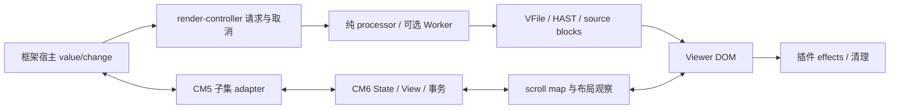

# CM5/CM6 生产架构裁决与 2.1.0 本地交付

**最终裁决：选择 CM6 2.1.0 作为后续生产架构，采用单一 CM6 内核、明确子集的 CM5 adapter、现有纯 processor/render-controller/Worker/DOM effects 分层。** main 1.22.4 的新增操作已整合；固定高度大文档启用 Worker 与 layoutContainment。选择依据是现有功能回归完整、默认同步首屏更快、事务/扩展结构便于持续维护，且最终长时间回收通过；接受本轮增强全量预览约 4%–8% 的回退，不宣称 CM6 输入或预览全面更快。

14 个包统一为本地稳定版 2.1.0，尚未上传 npm。依赖完整 CM5 Doc/addon 的旧集成可继续使用已发布的 1.22.4；2.1.0 的兼容面按迁移文档确定，不通过自动双内核切换掩盖差异。

## 架构差异与选择依据

| 层 | main / CM5 1.22.4 | feat/cm6 / 2.1.0 |
| --- | --- | --- |
| 编辑模型 | CM5 可变 Doc、命令与事件 | CM6 immutable Text、EditorState、事务和 EditorView |
| 扩展 | CM5 options、addons、keymap | CM6 Extension/Compartment；兼容 adapter 暴露明确子集 |
| 语言和高亮 | CM5 Markdown/GFM/YAML modes | Lezer Markdown/GFM/inline HTML；YAML frontmatter 装饰和统一主题 token |
| 宿主与插件 | 既有 CM5 API | 内置插件与 React/Vue/Svelte 包装保留；非完整 CM5 Doc 兼容 |
| 渲染 | 纯 processor → render-controller → DOM/plugin effects | 同一分层；Worker 执行同一纯解析链 |
| 大文档 | Worker 与固定高度 containment | 保留同样路径，不引入双内核自动切换 |

迁移的价值在原生事务、可组合扩展和后续维护。完整预览仍要全量解析并替换 DOM，换编辑内核无法消除这部分成本。对依赖未支持的 CM5 Doc/addon/options 的外部插件，1.22.4 仍是可用的兼容版本，升级按 [迁移矩阵](../docs/migration-cm5-to-cm6.md) 调整。

本批纳入的优化与修复：

- `getValue()` 按 immutable Text 身份缓存最近一次全文；原生事务、撤销、setValue 自然失效，销毁清空，不保留历史文档。
- 兼容快捷键回调收到 adapter，返回 false 放行；组合输入不触发兼容快捷键；setCursor 支持位置对象与 line/ch 两种 CM5 调用。
- Svelte 运行时作为实际 dependency，最低范围为已验证编译版本 ^5.57.3；准确保留 Svelte 条件声明、imperative ESM/CJS 与 props/events 类型。
- Vue 2 构建插件绑定工作区自身 compiler，避免 hoisted Vue 3 compiler 被错误解析。
- 高亮插件跳过未知显式语言，保留纯文本和 Mermaid 的独立渲染，避免 highlight.js 把 DOM 节点写入 DevTools console。
- `docs/index.md` 恢复普通文件模式，内容同步已生成的 README，消除历史 Git symlink 模式；生成校验和 Git 空白检查通过。

没有纳入跳过 rehypeRaw 的旁路：500 KiB profile 中该阶段约 575 ms / 总 2441 ms，但原型只验证 HTML 相同，HAST 元数据（例如 root.data.quirksMode）不同。插件可观察这些元数据，稳定版保留原解析语义。增量 AST、虚拟预览和跨请求处理结果缓存也不在本批中。

## 测量口径

Windows、Node 22.20.0、pnpm 8.15.9、独立 Headless Chrome 157、1280×800。同一 performanceFixture、生产 Vite build/preview；矩阵运行顺序执行，无后台回归/构建竞争。

CM5 基线来自 main e2f70d5 的隔离 worktree；仅加入相同采样页面与脚本。main 本身未改动。预览矩阵：10/100/500 KiB × core/enhanced × sync/worker × 3 = 每轮 36 样本。core 为基础解析，enhanced 含 GFM/语法高亮/数学/Mermaid。矩阵统一开启固定高度 layoutContainment，真实 CDP 键盘输入，默认 300 ms 预览 debounce。

矩阵中的 sync 是 async renderer 包装主线程纯 processor，保持两种 renderer 的 Viewer 生命周期一致；editorReadyMs 不能解释为默认同步首屏。另补不传 renderer、不启用 containment 的默认首屏 18 样本，记录构造耗时与 DOM/plugin 完成耗时。首屏是模块已加载、依赖已暖机后的编辑器挂载，未测冷网络下载。

编辑器隔离矩阵：3 尺寸 × 有/无 frontmatter × 3 = 18 组，每组 20 次真实按键。changeMs 是 keydown 到文档 change 通知；frameMs 是下一 RAF 可用时间，均不等同操作系统呈现延迟。100 次 getValue 的计时接近 0 时只代表低于采样精度。

### 最终版本与 CM5 对照

下表均为 3 次样本中位数，单位 ms；完整更新包括真实键盘输入序列及 300 ms debounce。不能把完整更新数值称为单字符输入延迟。

| 预览场景 | CM5 1.22.4 | CM6 最终代码 | 解释 |
| --- | --: | --: | --- |
| 100 KiB core Worker | 693.6 | 694.5 | 基本持平 |
| 100 KiB enhanced Worker | 941.9 | 980.2 | 本轮 CM6 +4.1% |
| 500 KiB core Worker | 2173.5 | 2163.7 | 基本持平 |
| 500 KiB enhanced Worker | 3242.2 | 3508.1 | 本轮 CM6 +8.2% |
| 500 KiB enhanced sync | 2991.3 | 3120.6 | 本轮 CM6 +4.3% |
| 500 KiB enhanced Worker 最大长任务 | 434 | 470 | DOM/plugin 工作仍会阻塞主线程 |
| 500 KiB enhanced sync 最大长任务 | 1845 | 1929 | Worker 对主线程阻塞的收益明显 |

整合 CM6 和第一轮缓存优化的 500 KiB enhanced Worker 分别为 3257.2 ms 和 3299.0 ms；最终轮为 3508.1 ms。样本仅 3 次、顺序而非随机交错运行，无法给出统计显著性或保证所有设备的差异小于某个百分比。结论是 CM6 没有稳定的全量预览速度优势，性能优化重点仍是解析/DOM/plugin 链路。

默认同步首屏（renderer 未传、containment 关闭）实测如下。构造结束仍不代表插件完成，但准确反映同步解析对构造调用的阻塞。

| 场景             | CM5 构造 / 完整首屏 | CM6 构造 / 完整首屏 |
| ---------------- | ------------------: | ------------------: |
| 10 KiB core      |         85.8 / 88.2 |         45.7 / 55.4 |
| 100 KiB core     |       524.4 / 533.1 |       342.9 / 408.3 |
| 100 KiB enhanced |       510.5 / 919.5 |       350.6 / 796.1 |
| 500 KiB core     |     2538.5 / 2572.8 |     1721.9 / 2169.5 |
| 500 KiB enhanced |     2767.2 / 4554.8 |     1872.9 / 3956.0 |

500 KiB enhanced 的构造阻塞约减少 32.3%，完整暖首屏约减少 13.1%；仍有约 1.87 秒同步构造，生产大文档建议使用 Worker。

编辑器隔离场景的 500 KiB 普通文档，CM5 文档 change 中位数约 1.3 ms、CM6 2.4 ms；带 frontmatter 时 CM6 7.9 ms，最大 RAF 31.8 ms。CM5 在纯输入通知路径仍快，CM6 在本组大文档输入保持可用，但不能称内核输入全面更快。100 次 getValue 的 CM5 中位数 52.0 ms、整合 CM6 18.7 ms，缓存后低于本采样精度；这是重复读全文成本的改善，不等同预览提速。

## 长时间内存与保留路径

初次两代各 30 分钟 enhanced/Worker 连续编辑、双向滚动、主题切换均完成输入与预览一致性，但销毁门槛失败，失败原始证据保留。

2 分钟带堆快照复现的强保留路径为：GC roots → Global handles → DevTools console → code.language-mermaid → 旧 markdown-body/preview/sidebar。highlight.js 的未知语言 fallback 把 code DOM 作为 console.log 参数；控制台因此留住整棵旧预览树。不能将这条 inspector 强引用解释成 CM6 内核泄漏。

同代码清理 Runtime.discardConsoleEntries 再强制 GC 的诊断复测，销毁后 nodes/listeners 增量 0/0，JS heap +2,910,624 bytes。最终版本额外在插件侧避免产生该日志，并再次运行长时间复验。计数包含 detached/transient DOM，mounted 计数增长不能单独证明泄漏；回收门槛与堆快照一起评估。

长时间两轮可并行独立 Chrome，并允许后台验收；它们提供稳定性/回收证据，不用于两代性能排名。销毁后等待 1 秒、5 秒并强制 GC；门槛为 nodes/listeners 增量 ≤0、heap 增量 <5 MiB。通过只覆盖本次 fixture、操作和时长，不证明所有宿主无限时长无泄漏。

最终两代各 30 分钟均 passed，页面异常为 0，持续断言编辑值与完整预览一致：

| 架构 | 连续编辑次数 | 销毁节点增量 | 销毁监听器增量 | 销毁 JS heap 增量 |
| --- | --: | --: | --: | --: |
| CM5 1.22.4 | 1258 | 0 | 0 | +2,263,520 B（约 2.16 MiB） |
| CM6 2.1.0 | 1197 | 0 | 0 | +2,896,376 B（约 2.76 MiB） |

两者操作次数不同受并行后台负载影响，不能据此计算内核吞吐排名。CM6 前/后堆快照随最终运行保存；页面节点/监听器从 504/21 回到 504/21，5 秒 GC 后通过所有回收门槛。

## 最终验收与交付

用户确认人工中文输入法、真实移动设备和安全迁移已解决；本批只记录自动化证据，不重新声称完成这些人工检查。

已通过的验收：

| 项目 | 结果 | 证据 |
| --- | --- | --- |
| 核心 Vitest | 29 文件，256/256 | prod-perf-cm6-integration-20261104/final-core.log |
| Node 全部脚本 | 58/58，0 skipped | final-scripts.log |
| 关键脚本聚合覆盖率 | statements/lines 86.17%、branches 86.03%、functions 81.08% | final-scripts.log |
| 完整 ESM/CJS/d.ts/样式构建 | passed | final-build.log |
| tarball / Svelte props 类型 / 生产宿主 / SSR / 纯入口 | passed | packages-release.log |
| playground 开发 / 生产 | 各 18 项 passed，runtime errors 0 | playground-release.log |
| CM6 输入专项 | 25/25，实际 DOM composition 4 事件，console errors 0 | cm6-input-verified.log；prod-perf-cm6-input-9RKKL9/results.json |
| CM6 token/Enter/挂载销毁 | 100 次销毁 nodes/listeners 0/0 | cm6-closeout-verified.log |
| 仓库外最终 tarball 安装 | core / 全插件 / React / Vue 2 / Vue 3，5/5 | prod-perf-release-consumers-LtrRdH/results.json |
| 生成 / Prettier / Git 空白 | passed | generate-final.log / style-final.log；git diff --check |
| 本地 gzip 预算 | ESM 38,400 B；index.css 5,011 B；markdown.css 3,905 B，均低于门槛 | bundle-size-verified.log |
| 全量 / 定向发布演练 | staging 打包 passed，源 manifests 字节未变 | publish-dry-run-staging.log / publish-dry-run-targeted.log |

上表未带目录的日志均在 audit/prod-perf-cm6-integration-20261104/。覆盖率门槛是四个指定脚本的聚合值，不能解读为整个仓库覆盖率。

复现与原始数据目录（均保留本地、Git 忽略）：

- `prod-perf-cm5-final-baseline-20261104/`：CM5 的 36 组预览与 18 组内核数据。
- `prod-perf-architecture-cm6-integrated-LrfAqZ/`：整合 CM6。
- `prod-perf-architecture-cm6-optimized-3pelQl/`：第一次全文缓存优化。
- `prod-perf-architecture-cm6-final-7ZbZqY/`：最终代码的 36 预览 / 18 内核 / 18 默认首屏。
- `prod-perf-cm5-final-startup-20261104/`：CM5 默认首屏的 18 样本。
- `prod-perf-cm5-first-soak-20261104/` 和 `prod-perf-architecture-cm6-soak-isHmBn/`：控制台保留导致首次 30 分钟回收失败。
- `prod-perf-architecture-cm6-memory-diagnostic-WWU3D1/`：保留路径的前/后堆快照。
- `prod-perf-architecture-cm6-memory-console-clean-NhvK6a/`：清除 console 后的 2 分钟诊断复验。
- `prod-perf-cm5-final-soak-20261104/`：CM5 最终 30 分钟回收验收。
- `prod-perf-architecture-cm6-soak-final-Fgj866/`：CM6 最终 30 分钟及前/后堆快照。

交付 14 个 @jihua 包的 2.1.0 tarball 与 integrity/shasum 清单。沿用原 author/name/LICENSE；scope 与 workspace/npm alias 改写只在 staging 中进行。最终消费者在仓库外 TEMP 目录独立 npm install，不继承工作区 node_modules。按用户要求不登录、不发布 npm、不推送 Git。

原地 dry-run 两次遇到 Windows UNKNOWN open 错误，完整保留失败日志，并执行 --restore 恢复备份。演练入口已改为独立 staging/npm pack，无需改写源码文件；全量与定向演练通过并校验源 manifests 字节不变。正式 npm 发布的备份/恢复路径未在本批实际联网执行。

bundlewatch 的本地尺寸计算通过，但其 URL 短链上报返回错误；仓库新增 test:bundle-size 使用相同 gzip level 9 与原预算进行纯本地验收。上表的包体积结论不依赖远程上报成功。

最后全量回归后再次构建并打包，14 个 tarball 的 integrity/shasum/尺寸与仓库外消费已通过的发行目录完全一致。交付目录为 `audit/prod-perf-release-gRejJF/`，含安装说明、迁移文档、完整报告、14 个包及 ZIP 合集。所有本批采样服务和独立 Chrome 均已退出；CM5 的基线 checkout 保留，完整证据已复制到主目录。
