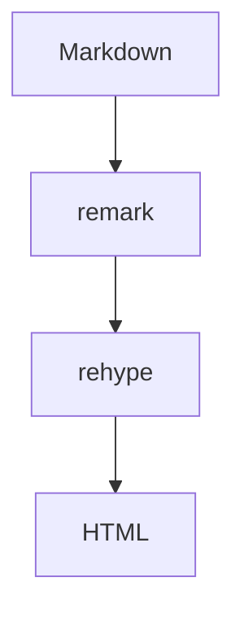

# ByteMD 功能全览

> 这份示例覆盖标准 Markdown、GFM 扩展、常用插件与 ByteMD 新增语法。
> 预览区使用标准主题 `bytemd/dist/markdown.css`，编辑器外壳使用 `bytemd/dist/index.css`。

## 标题层级

### 三级标题

#### 四级标题

##### 五级标题

###### 六级标题

## 文本样式

这是一段普通文字，包含 **加粗**、*斜体*、~~删除线~~、`行内代码`、[行内链接](https://github.com/bytedance/bytemd 'ByteMD')、[引用式链接][bytemd]，以及转义的 \*星号\*。

[bytemd]: https://github.com/bytedance/bytemd

## 字号

整行放大：

[size=22]这一行使用 22px 字号[/size]

局部放大：这段文字中的 [size=32]重点内容[/size] 会变大，其余保持默认。

整段包裹时，内部仍支持 **加粗**、[链接](#字号) 与行内代码 `const answer = 42`：

[size=20]这一段整体使用 20px，包含 **加粗**、[链接](#字号) 与行内代码 `const answer = 42`，验证行内节点混排。[/size]

## 颜色

字体颜色：[color=#e03131]红色重点[/color]、[color=#1971c2]蓝色说明[/color]、[color=#2f9e44]绿色结论[/color]。

背景颜色：[bg=#fff3bf]黄色高亮[/bg]、[bg=#d3f9d8]绿色高亮[/bg]、[bg=#d0ebff]蓝色高亮[/bg]。

组合使用：[size=24][color=#e03131][bg=#fff3bf]大字 + 红字 + 黄底[/bg][/color][/size]

## 引用与分割线

> 普通引用块：Markdown 的基础引用样式。
>
> > 嵌套引用：引用里还可以继续引用。

---

带文字的分割线：

---居中文字---

标签内也支持 **加粗**、[链接](#引用与分割线) 与 `行内代码`：

---**重点** 与 [链接](#引用与分割线)---

图标分割线（图片自动限制到图标大小）：

------

普通 `---` 仍是普通分割线。

## 列表

### 无序列表

- 第一项
- 第二项
  - 嵌套项 A
  - 嵌套项 B
- 第三项

### 有序列表

1. 第一步
2. 第二步
   1. 子步骤
   2. 子步骤
3. 第三步

### 任务列表

- [x] 已完成事项
- [ ] 待办事项
- [ ] 另一个待办

## 表格

| 语法 | 说明 | 示例 |
| --- | --- | --- |
| 粗体 | 强调重点 | **bold** |
| 斜体 | 轻量强调 | *italic* |
| 行内代码 | 命令/标识符 | `npm run dev` |
| 链接 | 跳转 | [ByteMD](https://github.com/bytedance/bytemd) |

## 代码

行内代码：`const answer = 42`。

### TypeScript

```ts
import gfm from '@bytemd/plugin-gfm'
import { Editor } from 'bytemd'

interface EditorOptions {
  target: HTMLElement
  value: string
}

export function mountEditor({ target, value }: EditorOptions) {
  return new Editor({
    target,
    props: {
      value,
      plugins: [gfm()],
    },
  })
}
```

### Bash

```bash
pnpm install
pnpm --filter playground dev
pnpm test
pnpm build
```

### JSON

```json
{
  "name": "bytemd",
  "version": "1.22.0",
  "features": ["markdown", "gfm", "math", "mermaid", "timeline"]
}
```

### 超长行（验证横向滚动）

```js
const message = '这一行故意写得很长，用来验证代码块横向滚动时，右上角的复制按钮仍然固定在头部，不会压住任何一行代码。'
const tools = ['accordion', 'pinyin', 'timeline', 'callout']
console.log(message, tools.join(' / '))
```

### 无语言标记

```
plain text block
  without a language label
```

## 图片


图片支持 Medium Zoom：点击图片可以放大查看，多张图片可在灯箱内左右切换。

## GFM 扩展

自动链接：https://github.com/bytedance/bytemd

~~删除线~~ 也会在 GFM 中生效。

## Gemoji

:+1: :smile: :rocket: :family_man_man_boy_boy:

## 数学公式

行内公式：$a^2 + b^2 = c^2$。

$$
\displaystyle \left( \sum_{k=1}^n a_k b_k \right)^2
\leq
\left( \sum_{k=1}^n a_k^2 \right)
\left( \sum_{k=1}^n b_k^2 \right)
$$

## Mermaid 图表



## 提示块 Callout

>[default] 默认提示：用于补充说明。

>[success] 成功：操作已经完成。

>[warning] 警告：此操作不可撤销。

>[info] 信息：这是一条中性消息。

>[danger] 重要：发生错误，请立即处理。

## 手风琴 Accordion

+++ 点击展开更多
这里是被收起的内容。
++- 默认展开
这段内容默认展开。
++ 默认收起
这段内容默认收起。
+++

## 拼音 Pinyin

{拼 音|Ping Yin} 是汉语拼音的注音示例。

{中 华 人 民|Zhong Hua Ren Min} 也可以按字对齐。

## 时间线 Timeline

::: timeline 时间线
:: [done] 2024-01-15 项目立项
   完成需求评审
:: [doing] 2024-03-20 Alpha 版本
   正在联调
:: [todo] 2024-06-01 正式上线
:: [error] 2024-07-01 严重回滚事件
:: [milestone] 2024-08-01 用户破万
:::

## 说明

本示例覆盖 playground 默认启用的插件与内置语法。脚注需要额外启用 `@bytemd/plugin-footnotes`，未包含在此示例中。
