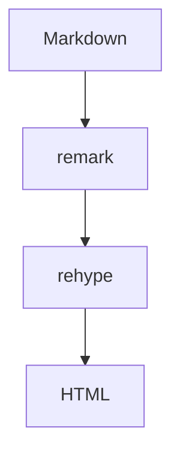

# ByteMD 功能全览

> 这份示例覆盖标准 Markdown、GFM 扩展、常用插件与 ByteMD 新增语法。
> 预览区使用标准主题 `bytemd/dist/markdown.css`，编辑器外壳使用 `bytemd/dist/index.css`。

## 标题层级

### 三级标题

#### 四级标题

##### 五级标题

###### 六级标题

## 文本样式

这是一段普通文字，包含 **加粗**、*斜体*、~~删除线~~、`行内代码`、[行内链接](https://github.com/bytedance/bytemd 'ByteMD')、[引用式链接][bytemd]，以及转义的 \*星号\*。

[bytemd]: https://github.com/bytedance/bytemd

## 引用与分割线

> 普通引用块：Markdown 的基础引用样式。
>
> > 嵌套引用：引用里还可以继续引用。

---

## 列表

### 无序列表

- 第一项
- 第二项
  - 嵌套项 A
  - 嵌套项 B
- 第三项

### 有序列表

1. 第一步
2. 第二步
   1. 子步骤
   2. 子步骤
3. 第三步

### 任务列表

- [x] 已完成事项
- [ ] 待办事项
- [ ] 另一个待办

## 表格

| 语法 | 说明 | 示例 |
| --- | --- | --- |
| 粗体 | 强调重点 | **bold** |
| 斜体 | 轻量强调 | *italic* |
| 行内代码 | 命令/标识符 | `npm run dev` |
| 链接 | 跳转 | [ByteMD](https://github.com/bytedance/bytemd) |

## 代码

行内代码：`const answer = 42`。

```ts
import gfm from '@bytemd/plugin-gfm'
import { Editor } from 'bytemd'

const editor = new Editor({
  target: document.body,
  props: {
    value: '',
    plugins: [gfm()],
  },
})
```

## 图片


图片支持 Medium Zoom：点击图片可以放大查看。

## GFM 扩展

自动链接：https://github.com/bytedance/bytemd

~~删除线~~ 也会在 GFM 中生效。

## Gemoji

:+1: :smile: :rocket: :family_man_man_boy_boy:

## 数学公式

行内公式：$a^2 + b^2 = c^2$。

$$
\displaystyle \left( \sum_{k=1}^n a_k b_k \right)^2
\leq
\left( \sum_{k=1}^n a_k^2 \right)
\left( \sum_{k=1}^n b_k^2 \right)
$$

## Mermaid 图表



## 提示块 Callout

>[default] 默认提示：用于补充说明。

>[success] 成功：操作已经完成。

>[warning] 警告：此操作不可撤销。

>[info] 信息：这是一条中性消息。

>[danger] 重要：发生错误，请立即处理。

## 手风琴 Accordion

+++ 点击展开更多
这里是被收起的内容。
++- 默认展开
这段内容默认展开。
++ 默认收起
这段内容默认收起。
+++

## 拼音 Pinyin

{拼 音|Ping Yin} 是汉语拼音的注音示例。

{中 华 人 民|Zhong Hua Ren Min} 也可以按字对齐。

## 时间线 Timeline

::: timeline 时间线
:: [done] 2024-01-15 项目立项
   完成需求评审
:: [doing] 2024-03-20 Alpha 版本
   正在联调
:: [todo] 2024-06-01 正式上线
:: [error] 2024-07-01 严重回滚事件
:: [milestone] 2024-08-01 用户破万
:::

## 说明

本示例覆盖 playground 默认启用的插件与内置语法。脚注需要额外启用 `@bytemd/plugin-footnotes`，未包含在此示例中。
